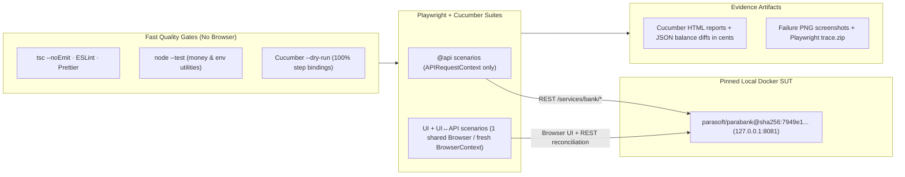

# ParaBank Banking QA Automation Platform

[](https://github.com/vmurashev365/ParabankDemo/actions/workflows/parabank-v4-smoke.yml)

This portfolio project verifies customer banking workflows against a digest-pinned local ParaBank instance. Cucumber expresses the banking rules, Playwright drives the browser and REST API client, TypeScript enforces type safety, and Node's built-in test runner validates currency math without launching a browser.

## Architecture



## Banking workflows

| Workflow          | What the test verifies                                                                                                                                                                                   |
| ----------------- | -------------------------------------------------------------------------------------------------------------------------------------------------------------------------------------------------------- |
| Internal transfer | Move $25.37 (and $0.01) between checking and savings. Verify receipt details, compare both closing balances in integer cents in the UI, reconcile both balances via REST API, and verify ledger entries. |
| Bill payment      | Verify payee, amount, and funding account on the receipt, assert exact debit in cents plus REST API ledger entry, and prove rejected payments (mismatched payee account) leave the balance unchanged.    |
| Customer access   | Sign in, inspect accounts overview and account details, sign out, reject SQL-injection payloads on login, and exercise synthetic customer registration and validation rules.                             |
| Banking REST API  | Authenticate customers, reject invalid credentials, list customer accounts, and execute direct API transfers with cent-exact balance and transaction ledger verification without launching a browser.    |
| Money utilities   | Unit-test USD-to-cents parsing, API float-to-cents rounding, integer currency formatting, and base URL resolution via `node --test` in under a second.                                                   |

Start with [transfer.feature](features/transfer.feature), [api.feature](features/api.feature), [accounts.steps.ts](src/steps/accounts.steps.ts), [api.steps.ts](src/steps/api.steps.ts), and [money.ts](src/support/money.ts) to follow the money across UI and REST API.

## Quick start

Use Node.js 22+ and Docker Compose. Run these commands from `ParabankDemo-v4/`.

```sh
npm ci
npx playwright install chromium
npm run docker:start
```

Once `http://127.0.0.1:8081/parabank/index.htm` responds, run the unit, API, and smoke checks:

```sh
npm run test:unit
npm run test:api
npm run test:smoke
```

Open [the Cucumber HTML report](reports/cucumber/report.html) after a run. Balance assertions attach a JSON snapshot (`opening`, `expectedClosing`, `actualClosing` in cents) plus UI-vs-API reconciliation data. Failed browser scenarios attach a PNG screenshot and save a Playwright trace archive in `reports/traces/`.

## Running tests

| Command                                                      | Selection                                                                        |
| ------------------------------------------------------------ | -------------------------------------------------------------------------------- |
| `npm run test:unit`                                          | Unit tests for currency math and env resolution (no browser, no Docker required) |
| `npm run test:api`                                           | Pure REST API scenarios (`@api`, never launches Chromium)                        |
| `npm run test:smoke`                                         | Core UI + UI↔API smoke checks (`@smoke and not @api`)                           |
| `npm run test:regression`                                    | Full regression & security suite (`@regression and not @known-bug`)              |
| `npm run test:known-bugs`                                    | Tracked application defects (`@known-bug`) isolated from green CI                |
| `npm run test:security`                                      | SQL injection and browser compatibility checks                                   |
| `npm run test:dry-run`                                       | Verify 100% step bindings without opening a browser                              |
| `npm run type-check`, `npm run lint`, `npm run format:check` | TypeScript, ESLint, and Prettier gates across `src/` and `tests/`                |
| `npm run docker:stop`                                        | Stop this project's local ParaBank container                                     |

## Test data and environment

The pinned Docker image supplies the demo customer `john` / `demo`, checking account `54321`, and savings account `13344`. UI scenarios reuse one browser process per worker while isolating every scenario in a fresh `BrowserContext`. Because the demo accounts persist across scenarios, Cucumber runs serially (`parallel: 1`) so balance deltas remain deterministic. Use a dedicated ParaBank instance while comparing balances.

The default host is `http://127.0.0.1:8081`. Override `PARABANK_BASE_URL` for another instance, `PARABANK_USERNAME` / `PARABANK_PASSWORD` for custom credentials, `PARABANK_HEADLESS=false` for headed debugging, `PARABANK_BROWSER` (`chromium`, `firefox`, or `webkit`) to switch engines, and `PARABANK_TERMINAL_MODE=silent` to suppress per-step terminal logs.

## Known findings

- **Empty transfer amount (`@known-bug`).** On the pinned image, submitting an empty transfer amount calls the backend AJAX endpoint directly and displays a generic error banner while leaving `#amount.errors` hidden. The scenario in [transfer.feature](features/transfer.feature) is explicitly tagged `@known-bug` so it stays documented and runnable via `npm run test:known-bugs` without turning `@regression` red.

See the [coding guide](docs/CODING_STANDARDS.md) for the conventions used to extend the suite.
